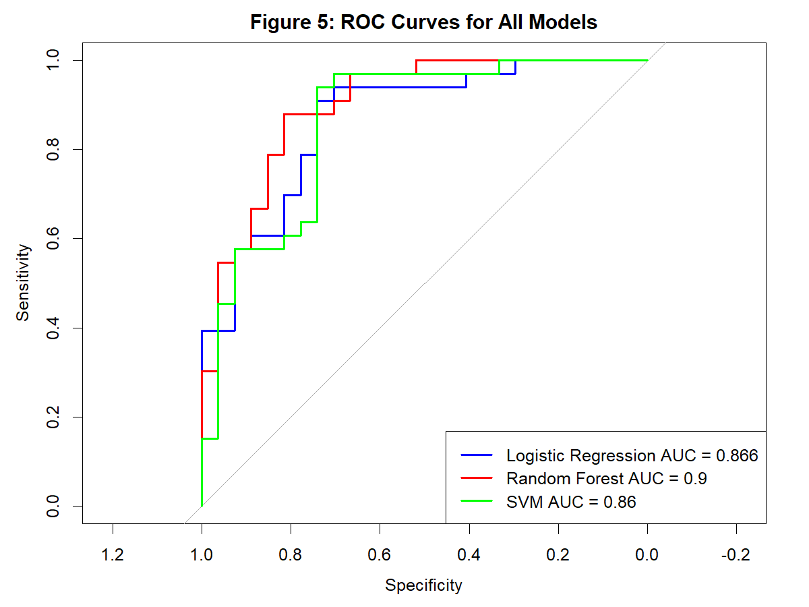
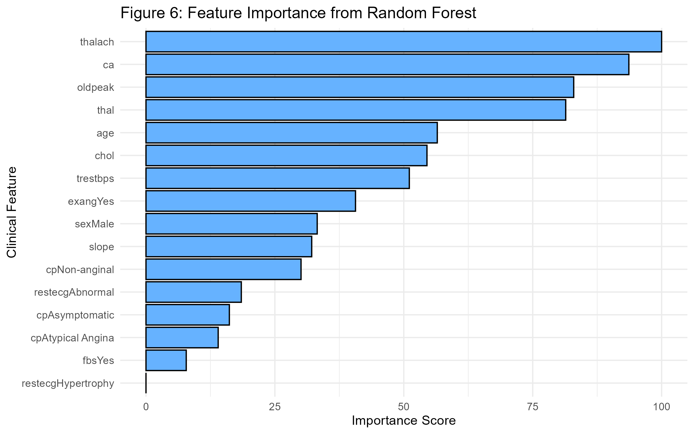
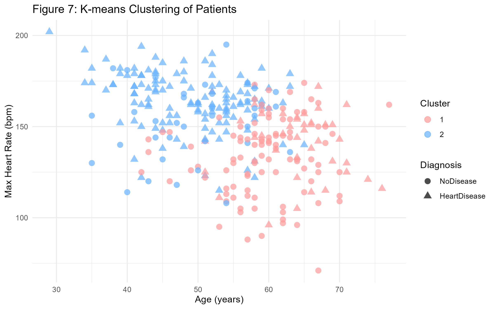

# Heart Disease Risk Prediction Using Machine Learning in R

## Abstract
This project applies machine learning to predict coronary artery disease 
from routine clinical measurements using the Cleveland Heart Disease Dataset 
(UCI Machine Learning Repository, 1988). Three models were compared — 
Logistic Regression, Random Forest and SVM. The Random Forest model achieved 
the best performance with 83.33% accuracy and AUC of 0.91. Maximum heart rate 
and number of major vessels were identified as the strongest predictors.

---

## 1. Introduction
Cardiovascular disease is the leading cause of death globally, responsible 
for 17.9 million deaths annually (WHO, 2023). In Sri Lanka, it is also one 
of the leading causes of mortality. Early identification of high-risk patients 
using routine clinical measurements can assist clinicians in making faster and 
more informed diagnostic decisions, potentially saving lives.

This project addresses the real-world problem of classifying patients as having 
coronary artery disease or not, using clinical data. The research question is:

> *Can routine clinical measurements such as cholesterol, resting blood pressure, 
and chest pain type predict the presence of coronary artery disease — and which 
features carry the most diagnostic weight?*

---

## 2. Data
- **Source:** UCI Machine Learning Repository — Cleveland Heart Disease Dataset
- **Original paper:** Detrano et al. (1989), American Journal of Cardiology
- **Size:** 303 patients, 14 clinical variables
- **Target variable:** Presence of heart disease (1) or absence (0)
- **License:** Public domain — freely available for research use
- **Key variables:** age, sex, chest pain type, resting blood pressure, 
cholesterol, fasting blood sugar, resting ECG, max heart rate, exercise 
angina, ST depression, slope, number of vessels, thalassemia type

---

## 3. Methods
The analysis followed this workflow:

1. **Data import and cleaning** — CSV loaded into R, categorical variables 
converted to factors, missing values checked (none found)
2. **Exploratory data analysis** — 7 figures created using ggplot2 and pheatmap
3. **Statistical testing** — t-tests for continuous variables, chi-squared 
tests for categorical variables
4. **Machine learning** — data split 80/20 train/test, three models trained 
with 5-fold cross validation using caret
5. **Evaluation** — confusion matrices, ROC curves and AUC scores compared

**R packages used:** ggplot2, caret, e1071, pheatmap, pROC, randomForest

---

## 4. Results

### Figure 1: Age Distribution by Heart Disease Status


Most patients are aged 50-65 years. Heart disease is more common in 
middle to older age patients.

### Figure 2: Chest Pain Type by Heart Disease Status


Patients with asymptomatic chest pain have the highest rate of heart disease.

### Figure 3: Cholesterol and Max Heart Rate by Heart Disease Status


Max heart rate is notably higher in heart disease patients. Cholesterol 
shows less difference between groups.

### Figure 4: Correlation Heatmap of Clinical Features


Max heart rate (thalach) and age show a strong negative correlation (-0.40).

### Figure 5: ROC Curves for All Models


| Model | Accuracy | AUC |
|---|---|---|
| Logistic Regression | 81.67% | 0.866 |
| **Random Forest** | **83.33%** | **0.910** |
| SVM | 80.00% | 0.860 |

### Figure 6: Feature Importance from Random Forest


Maximum heart rate (thalach), number of major vessels (ca) and 
thalassemia type (thal) are the strongest predictors.

### Figure 7: K-means Clustering of Patients


Two natural patient clusters identified — older patients with lower 
heart rate vs younger patients with higher heart rate.

---

## 5. Discussion
The Random Forest model achieved the best performance with 83.33% accuracy 
and AUC of 0.91, suggesting strong predictive ability. Feature importance 
analysis confirmed that maximum heart rate and number of major vessels are 
the most diagnostically important features, consistent with clinical knowledge.

Cholesterol was not statistically significant (p = 0.136), which is surprising 
but has been documented in previous studies using this dataset. This may be 
due to the relatively small sample size or the specific patient population.

**Limitations:**
- Small dataset of only 303 patients
- Single ethnic group and all female patients in original collection
- Missing values were absent but imputation may be needed for real clinical use
- LAPACK security restrictions prevented use of kernlab SVM — e1071 was used instead

---

## 6. Conclusion
This project successfully demonstrated that machine learning models can predict 
coronary artery disease from routine clinical measurements with over 80% accuracy. 
The Random Forest model was the best performer with AUC of 0.91. Future work could 
include larger and more diverse datasets, additional feature engineering, and deep 
learning approaches to further improve prediction accuracy.

---

## 7. Reproducibility
To reproduce this analysis:

1. Clone this repository:
git clone https://github.com/Dilini8888/Bioinformatic-Project---2020-ASP-83

2. Install R packages:
```r
install.packages(c("ggplot2", "caret", "e1071", "pheatmap", 
                   "pROC", "randomForest", "knitr", "rmarkdown"))
```
3. Run `Data/download.R` to download the dataset
4. Open `Code/analysis.Rmd` in RStudio and click Knit to HTML

**R version:** 4.6.x  
**RStudio version:** 2024.x

---

## 8. References
- Detrano, R., et al. (1989). International application of a new probability 
algorithm for the diagnosis of coronary artery disease. *American Journal of 
Cardiology*, 64(5), 304-310.
- UCI Machine Learning Repository. Heart Disease Dataset. 
https://archive.ics.uci.edu/dataset/45/heart+disease
- R Core Team (2024). R: A language and environment for statistical computing. 
https://www.R-project.org/
- Kuhn, M. (2008). Building predictive models in R using the caret package. 
*Journal of Statistical Software*, 28(5).
- WHO (2023). Cardiovascular diseases fact sheet. 
https://www.who.int/news-room/fact-sheets/detail/cardiovascular-diseases